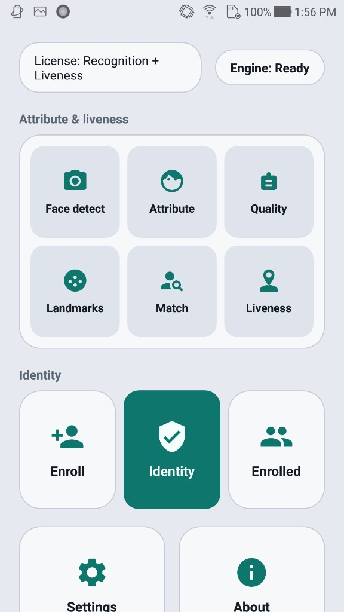
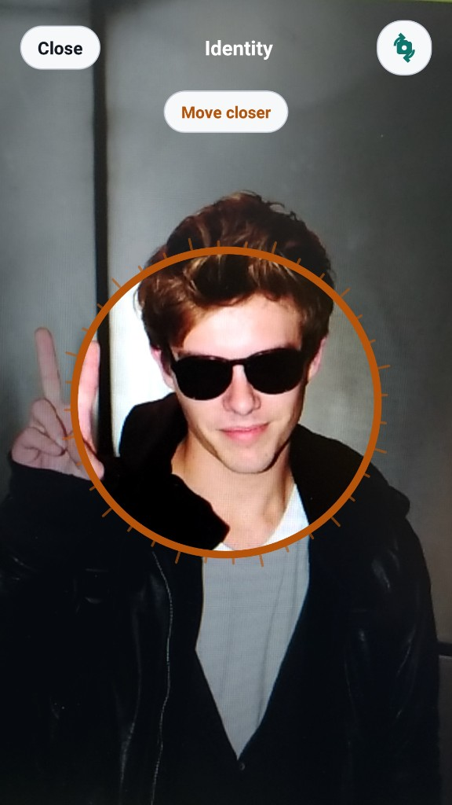
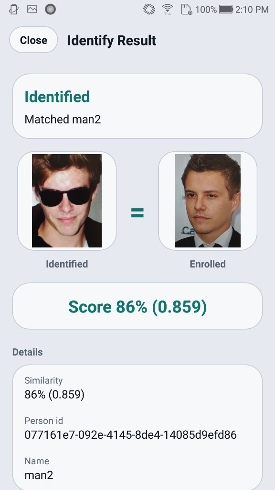
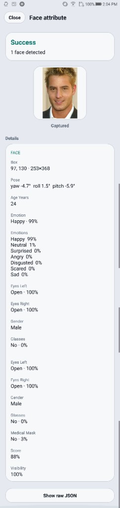
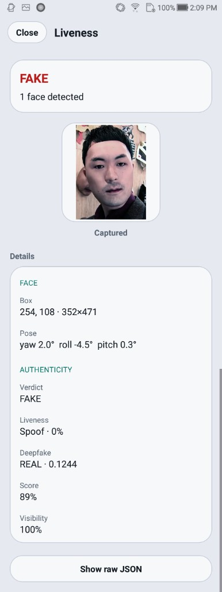
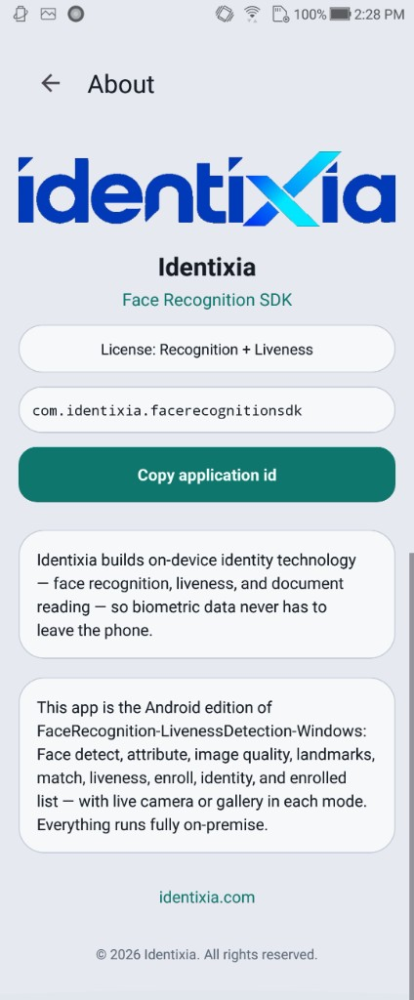

# Face SDK — iOS


## Overview

Face recognition SDK for iOS. On-device enrollment, 1:N identification, and face attributes for KYC, plus passive liveness when the license includes it.

Processing runs **on the device**. Identixia does **not** receive biometric images, templates, or document scans.

| | |
| --- | --- |
| **Repository** | [`FaceRecognition-LivenessDetection-iOS`](https://github.com/identixia-IDV/FaceRecognition-LivenessDetection-iOS) |
| **Platform** | iOS |
| **Documentation** | [docs.identixia.com](https://docs.identixia.com) |


## Repository



[`identixia-IDV/FaceRecognition-LivenessDetection-iOS`](https://github.com/identixia-IDV/FaceRecognition-LivenessDetection-iOS) · [Releases](https://github.com/identixia-IDV/FaceRecognition-LivenessDetection-iOS/releases/latest)

## Capabilities

| Capability | Description |
| --- | --- |
| Face detection | Bounding box, landmarks, and pose |
| Attributes | Age, gender, and related traits when enabled |
| Quality | ICAO-style image and face quality scores |
| Templates | Compact feature vectors stored in **your** database |
| 1:1 match | Compare two images or two templates |
| 1:N identify | Enroll a gallery and search (mobile VideoWorker / server gallery) |
| Passive liveness + deepfake | PAD and deepfake together when the license includes `liveness`; REAL only if both pass |

## Prerequisites

| Requirement | Detail |
| --- | --- |
| IDE | Xcode (recent stable) |
| Device | Physical iPhone for camera demos |
| Deployment | iOS 13+ (see sample project) |
| Frameworks | Vendored `.framework` / `.xcframework` from Release or Drive pack |

## Download and place the runtime

Native engines and model databases are **not** stored in git. Every product ships `scripts/get_runtime.py`, which downloads the correct GitHub Release assets and places them where the sample expects.

### Download (recommended)

```bash
python scripts/get_runtime.py
```

To pin a specific Release tag:

```bash
python scripts/get_runtime.py --tag 1.0.0
```

| | |
| --- | --- |
| **Release asset** | `facerecognitionsdk-ios.zip` (frameworks + `databases/*.xdb`) |
| **Local path after download** | Repository root / `Frameworks/` + `databases/*.xdb` |
| **Databases** | Place every `*.xdb` from the Release next to the frameworks (or under `databases/`). |

### Manual download (optional)

Open the repository **Releases** page and download the asset named above:

```text
https://github.com/identixia-IDV/FaceRecognition-LivenessDetection-iOS/releases/latest/download/<asset>
```

Unzip so files land in the documented path — **not** nested inside an extra folder.


If databases are missing, activate/init may succeed but recognition, liveness, or OCR will fail at runtime. `get_runtime.py` checks required packs after download.


## Integration guide — start the project

### 1. Clone the sample

```bash
git clone https://github.com/identixia-IDV/FaceRecognition-LivenessDetection-iOS.git
cd FaceRecognition-LivenessDetection-iOS
```

### 2. Download and place the runtime

See [Download and place the runtime](#download-and-place-the-runtime) below. From the repository root:

```bash
python scripts/get_runtime.py
```

### 3. Run the demo

Open the Xcode project, set your signing **Team**, and run on a physical iPhone.

Wait until Home status shows **Ready** before opening camera modes.

### 4. Activate and try every mode

1. Confirm Home / About shows a licensed **Ready** state (sample apps ship a demo key for the sample application id only).
2. Exercise each demo tile once (enroll, identify, capture, attribute, liveness, document front/back, result).
3. For your own app: request a license for **your** application id / bundle id, then call activate → init on a background thread.


## License and activation (mobile)

| | |
| --- | --- |
| **Demo id** | `com.identixia.facerecognitionsdk` (Android) / matching iOS bundle id in the sample |
| **Demo key** | Bundled for the sample id only |
| **Your app** | New applicationId / bundle id → request a new license |

### Activate → init (concept)

1. Call activate with your license string (background thread).
2. On success, call init (unpacks on-device models; may take a few seconds the first time).
3. Gate UI on Ready / license status before camera modes.
4. Never paste the demo key into a production app id.


### Status codes

| Code | Meaning |
| ---: | ------- |
| `0` | Success |
| `1` / `-1` | Invalid license |
| `2` / `-2` | Wrong application / bundle id |
| `3` / `-3` | License expired |
| `4` / `-4` | Not activated |
| `-5` | Init / model load failed |
| `-10` | Invalid argument |
| `-11` | Invalid image |
| `-12` | No face |
| `-13` | No document |
| `-16` | Liveness failed (when gated) |

Serialize native SDK calls on **one background thread**. The engine is not concurrent.


## API reference — mobile face SDK

Prefer **`FaceRecognitionClient`** (Android kit) / the matching iOS kit wrappers. Flutter, React Native, and Ionic expose the **same method names** as Android (`detect`, `faceDetection`, `liveness`, `livenessAll`, …). Serialize all engine calls on **one background thread**.

### Lifecycle

| API | Purpose |
| --- | --- |
| `setActivation(license)` / kit `activate(license)` | Activate (+ init) on a worker thread |
| `init()` | Load models when not bundled into activate |
| `deinit()` / `deactivate()` / `release()` | Tear down engine |
| `getMachineCode()` | Offline machine / app fingerprint helpers |
| `getLicenseStatus()` | Current license flags |
| `allowsRecognition()` / `allowsLiveness()` | Capability checks |

### Still-image recognition

| API | Purpose | Closest HTTP route |
| --- | --- | --- |
| `detect(image, crop?, flags?)` | Detect faces; JSON with regions / landmarks / traits | `POST /api/face/analyze` |
| `faceDetection(image, param?)` | Typed `FaceBox` list / JSON boxes | `POST /api/face/boxes` |
| `faceDetect` / `faceAttribute` / `imageQuality` / `landmarks` | Focused still helpers (plugin channels) | `/api/face/traits`, `/image-quality`, `/landmarks` |
| `match(image1, image2)` | 1:1 image compare | `POST /api/face/compare` |
| `templateExtraction(image, face)` | Template bytes for one face box | `POST /api/face/template` |
| `extractFeature(image)` | Feature bytes (largest / primary face) | `POST /api/face/template` |
| `similarity(feature1, feature2)` | 1:1 score between templates | `POST /api/face/score` |
| `quality(image, crop?)` | Quality attributes JSON | `POST /api/face/quality` |
| `setLandmarkMode(14\|68)` | Landmark density | — |

### Passive liveness + deepfake (when licensed)

| API | Purpose | Closest HTTP route |
| --- | --- | --- |
| `liveness(image)` | PAD + deepfake | `POST /api/face/liveness` |
| `livenessAll(image)` | Same as `liveness`, high-accuracy pack | `POST /api/face/liveness` |
| `deepfake(image)` | Deepfake-only still check | `POST /api/face/deepfake` |

Treat authenticity as **REAL** only when both PAD and deepfake say real. Without the entitlement, treat missing scores as **not run**, not as pass.

### Gallery (on-device 1:N)

| API | Purpose |
| --- | --- |
| `enroll(name, feature, thumbnail?)` | Store person locally |
| `bestMatch(feature, threshold)` | 1:N search |
| `enrolledPeople()` / `removeEnrolled` / `clearEnrolled` | Gallery management |
| `syncDatabase(matchThreshold)` | Push templates into VideoWorker DB |

### Live camera (VideoWorker)

| API | Purpose |
| --- | --- |
| `startVideoWorker(config)` | Start tracking / identify session |
| `addFrame` / live-frame helpers | Push camera frames |
| `setVideoWorkerEventHandler` | Receive track / match / liveness events (JSON) |
| `stopVideoWorker()` | Stop session |
| `makeTrackingConfig` / `makeIdentityConfig` | Build configs (passive / active liveness options when licensed) |

### Usage example (Android kit)

```kotlin
val client = FaceRecognitionClient.get(context)
client.activate(licenseKey) { code ->
    if (code != 0) return@activate
    // Worker thread: detect + match
    val json = client.detect(bitmap, /* crop */ false, /* flags */ 0)
    val score = client.match(bitmapA, bitmapB)
    val live = client.liveness(bitmap) // when licensed
}
```

### Usage example (plugin / Flutter / React Native / Ionic)

Call the same method names exposed by the plugin bridge (`activate` → `init` → `detect` / `match` / `liveness` / `enroll`). Keep camera preview on the UI thread; keep engine calls on a single background isolate / queue.

### Integration checklist

1. Download runtime with `python scripts/get_runtime.py` (or `install.gradle` on Android).
2. `FaceRecognitionClient.get(context).activate(license) { code -> … }` (or `setActivation` → `init` on plugins).
3. On `0`, enable camera modes.
4. Enroll → Identify, or Capture / Attribute / Liveness for still flows.
5. Persist templates in **your** database if you leave the demo gallery.

## Troubleshooting

| Symptom | What to check |
| --- | --- |
| Invalid license | Application / bundle id must match the key; server needs the correct machine code |
| Init failed | Runtime AAR/framework/`lib` missing or wrong ABI |
| No face / no document | Lighting, crop, distance; try still gallery image first |
| Liveness / authenticity empty | License flag off — request the matching entitlement |
| Camera black / crash | Use a **physical** device; grant camera permission |
| Docker license fails after bare-metal license | Machine codes differ — re-license the container |

## Related platforms

Keep the same license product line across stacks. From the [Face SDK](README.md) hub:

| Platform | Docs |
| --- | --- |
| Android (full) | [Android](android.md) |
| iOS (full) | [iOS](ios.md) |
| Flutter (full) | [Flutter](flutter.md) |
| React Native (full) | [React Native](react-native.md) |
| Ionic Capacitor (full) | [Ionic Capacitor](ionic-capacitor.md) |
| Ionic Cordova (full) | [Ionic Cordova](ionic-cordova.md) |
| Windows (full) | [Windows](windows.md) |
| Linux / Docker (full) | [Linux / Docker](linux-docker.md) |
| Windows (recognition only) | [Recognition Windows](recognition-windows.md) |
| Linux (recognition only) | [Recognition Linux / Docker](recognition-linux-docker.md) |
| Liveness-only | [Android](liveness-android.md) · [iOS](liveness-ios.md) · [Windows](liveness-windows.md) · [Docker](liveness-linux-docker.md) |
| Function guides | [Recognition](recognition.md) · [Liveness](liveness.md) |

## Screenshots

<figure><figcaption>iOS home</figcaption></figure>

<figure><figcaption>iOS capture</figcaption></figure>

<figure><figcaption>iOS identify</figcaption></figure>

<figure><figcaption>iOS attributes</figcaption></figure>

<figure><figcaption>iOS liveness</figcaption></figure>

<figure><figcaption>iOS about</figcaption></figure>

## Resources

| Resource | Link |
| --- | --- |
| **This repository** | [`identixia-IDV/FaceRecognition-LivenessDetection-iOS`](https://github.com/identixia-IDV/FaceRecognition-LivenessDetection-iOS) |
| **GitHub Releases (runtime)** | [Latest download](https://github.com/identixia-IDV/FaceRecognition-LivenessDetection-iOS/releases/latest) |
| **Runtime helper** | `python scripts/get_runtime.py` in the product clone |
| **Documentation site** | [docs.identixia.com](https://docs.identixia.com) |
| **SDK Server (HTTP)** | [SDK Server](../sdk-server/README.md) |
| **Website** | [identixia.com](https://identixia.com) |
| **Hugging Face** | [huggingface.co/Identixia](https://huggingface.co/Identixia) |
| **Docker Hub** | [hub.docker.com/u/identixia](https://hub.docker.com/u/identixia) |
| **Playground** | [playground.identixia.com](https://playground.identixia.com/) |
| **License & support** | [Request a license](../request-a-license-and-support.md) · [Contact](../contact-us.md) |

Postman collections live under each product repository’s `postman/` folder (and the monorepo `postman/Identixia-API.postman_collection.json` for all HTTP routes).

## Next steps

1. Complete **Integration guide — start the project** until the sample shows **Ready**.
2. Confirm runtime files and databases are in place (`python scripts/get_runtime.py`).
3. Activate with a license issued for **your** application id or machine code.
4. Call only the APIs your license allows; treat missing flags as “not evaluated”, not as pass.
5. Return to the [Face SDK](README.md) hub for recognition, liveness, and related platforms.


## Support



## Repository README

The following notes are adapted from the shipping repository README (exact commands and platform-specific details). Screenshots on this page use the Identixia documentation asset pack.

## Identixia Face Recognition — iOS

**On-device face recognition SDK** for iPhone: enroll, **1:N identification**, capture, attributes, and optional **passive face liveness + deepfake** (authenticity REAL only if both pass). Face template matching stays on device — Identixia cloud never sees your biometric frames. Built for private KYC selfie flows and on-device galleries.

Demo modes: **Enroll · Identify · Capture · Attribute**.

---

## Develop

Use this repository for on-device or on-premise face recognition with optional passive liveness and deepfake checks. Processing stays on the phone. Identixia does not receive camera frames, templates, or document images.

| | |
| --- | --- |
| **Architecture** | [Where the engine runs](#-architecture) |
| **Quick start** | Follow [Initial commands](#-initial-commands), then [Run](#-run). |
| **Initialize** | [Activate, then init](#-initialize) |
| **Process** | [Camera or a still image](#-process) |
| **Results** | [What to read back](#-results) |
| **Requirements** | [Requirements](#-requirements) |

---

## Resources

| Resource | Where |
| --- | --- |
| **Sample** | This repository — [FaceRecognition-LivenessDetection-iOS](https://github.com/identixia-IDV/FaceRecognition-LivenessDetection-iOS) |
| **Client library** | the sample project in this repository |
| **Runtime** | [`python scripts/get_runtime.py`](#-install) · [Releases](https://github.com/identixia-IDV/FaceRecognition-LivenessDetection-iOS/releases/latest) |
| **API** | [Method list](#-api) |
| **Develop docs** | [docs.identixia.com/face-sdk/ios](https://docs.identixia.com/face-sdk/ios) |
| **License** | [License](#-license) · [Contact](#-contact) |
| **Other platforms** | [Platforms](#-platforms) |

---

## Basics

Read this once before cloning. Mobile demos ship a **bundled license** for the sample application / bundle id. Production apps need a new key from Identixia. [Initial commands](#-initial-commands) lists clone → place runtime → run → activate options.

| Topic | Basic information |
| --- | --- |
| **Product** | On-device **face recognition SDK** for iOS |
| **Modes** | Enroll · Identify (1:N) · Capture · Attribute · optional passive liveness |
| **Runtime zip** | Three frameworks at repo root from Drive zip `PENDING` |
| **Demo id / license** | `com.identixia.facefullsdk.app` — use the sample id with the bundled demo license |
| **Activate** | Sample app: keep the demo id and bundled key. Your app: new applicationId / bundle id → [contact](#-contact) → call the SDK activate API (see docs). |
| **Tools** | **Xcode 15+** · physical **iPhone** |
| **UI** | Four demo modes after Ready |
| **Privacy** | Templates stay on device — no Identixia cloud |

---

## Initial commands

Clone the sample, place the runtime, and run it.

```bash
git clone https://github.com/identixia-IDV/FaceRecognition-LivenessDetection-iOS.git
cd FaceRecognition-LivenessDetection-iOS
python scripts/get_runtime.py
```

Download the runtime zip (`PENDING`) and place at repo root:

```text
facefullsdk.framework
FaceRecognitionEngine.framework
onnxruntime.framework
```

Open `FaceFullSDK.xcodeproj` → Signing Team → Run on a physical iPhone.

Please [contact us](#-contact) to get a license for your own app. The sample already includes a demo license for its application id.

Wait until Home status = **Ready**, then use Camera / Gallery (or the face mode tiles). Confirm Result / About shows a licensed state before integrating into your own app.

---

## What you get

| Capability | What it does |
| --- | --- |

---

## Demo modes

| Mode | What to try |
| --- | --- |
| **Enroll** | Store an on-device face template |
| **Identify** | Live 1:N against enrolled people |
| **Capture** | Guided still capture |
| **Attribute** | Attribute readout when enabled |

---

## Requirements

| | |
| --- | --- |
| Device | Physical **iPhone** |
| Tools | **Xcode 15+** |
| Demo bundle id | `com.identixia.facefullsdk.app` |
| Frameworks | `facefullsdk` · `FaceRecognitionEngine` · `onnxruntime` |

---

## Install

> **GitHub Release:** `python scripts/get_runtime.py` (or `--tag 1.0.0`)

Unzip to the repo root (siblings of the Xcode project):

```text
facefullsdk.framework
FaceRecognitionEngine.framework
onnxruntime.framework
```

---

## Run

```text
1. git clone https://github.com/identixia-IDV/FaceRecognition-LivenessDetection-iOS.git
2. Place the three frameworks at the repo root
3. Open FaceFullSDK.xcodeproj → set Signing Team
4. Keep bundle id com.identixia.facefullsdk.app for the demo license
5. Run on a physical iPhone → Enroll / Identify / Capture / Attribute
```

---

## License

| | |
| --- | --- |
| Demo bundle id | `com.identixia.facefullsdk.app` |
| Capabilities | Face recognition and/or passive face liveness + deepfake |

The code below shows how to use the license:

[https://github.com/identixia-IDV/FaceRecognition-LivenessDetection-iOS/blob/1946743e92f39e4d01740992b31cddf8c7c246ed/FaceFullSDK/Home/ViewController.swift#L8-L10](https://github.com/identixia-IDV/FaceRecognition-LivenessDetection-iOS/blob/1946743e92f39e4d01740992b31cddf8c7c246ed/FaceFullSDK/Home/ViewController.swift#L8-L10)

[https://github.com/identixia-IDV/FaceRecognition-LivenessDetection-iOS/blob/1946743e92f39e4d01740992b31cddf8c7c246ed/FaceFullSDK/Home/ViewController.swift#L167-L191](https://github.com/identixia-IDV/FaceRecognition-LivenessDetection-iOS/blob/1946743e92f39e4d01740992b31cddf8c7c246ed/FaceFullSDK/Home/ViewController.swift#L167-L191)

Please [contact us](#-contact) to get a license for **your own app**.

---

## Use in your app

Link the three frameworks, activate → init, then detect / template / match (and liveness when licensed). Do not ship a production key against the demo bundle id. See [docs](https://docs.identixia.com).

---

## Architecture

The native engine runs inside the app process. The first successful activate unpacks model databases onto the device. Keep `useLegacyPackaging = true` on Android when the engine loads `.so` files from the AAR.

## Initialize

The sample application id is already licensed. For your own id, request a new key, then call activate and init on a background thread. Open the camera only after the status is Ready. Do not reuse the sample key with a different application id.

| Code | Meaning |
| ---: | --- |
| `0` | Success |
| `1` / `-1` | Invalid license |
| `2` / `-2` | License was issued for a different application id |
| `3` / `-3` | License expired |
| `4` / `-4` | Not activated |
| `-5` | Models failed to load. Run `python scripts/get_runtime.py` and confirm the database packs are present. |
| `-12` | No face in the image |
| `-13` | No document in the image |

## Process

Enroll a person, then identify them, or compare two stills. Use a physical camera for the live sample.

## Results

Read the face box, template or similarity score, and the enrolled identity for 1:N. Liveness is a separate field. Do not treat a missing liveness score as a pass.

## API

The sample and your app use the same method names.

| API | What it returns |
| --- | --- |
| `activate(license)` then `init()` | Load the engine. Call both on one background thread. |
| `getLicenseStatus()` | Read flags before opening the camera. |
| `detect` / `faceAttribute` / `landmarks` | Still-image face, attributes, and landmarks. |
| `templateExtraction` / `similarity` | Template bytes and a 1:1 score. |
| `enroll` / `bestMatch` | On-device gallery and 1:N search. |
| `liveness` / `deepfake` | PAD and deepfake. REAL only if both pass. |

Camera frames stay on the UI thread. Engine calls stay on one background thread. The engine is not concurrent.

---

## Platforms

| | Platform | Repo |
| --- | --- | --- |

---
