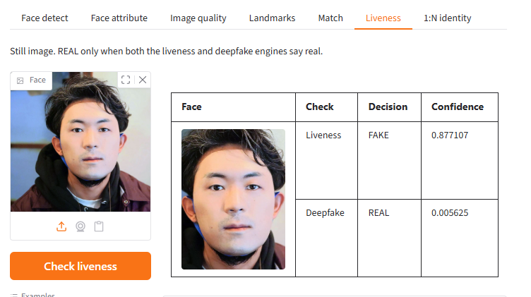

# Face liveness — Linux / Docker


## Overview

Passive face liveness SDK for Linux and Docker. On-premise REST API runs presentation-attack and deepfake checks together for KYC. A face is REAL only when both pass.

Processing runs **on your server (or in your container)**. Identixia does **not** receive biometric images, templates, or document scans.

| | |
| --- | --- |
| **Repository** | [`FaceLivenessDetection-Docker`](https://github.com/identixia-IDV/FaceLivenessDetection-Docker) |
| **Platform** | Linux |
| **Documentation** | [docs.identixia.com](https://docs.identixia.com) |


## Repository



[`identixia-IDV/FaceLivenessDetection-Docker`](https://github.com/identixia-IDV/FaceLivenessDetection-Docker) · [Releases](https://github.com/identixia-IDV/FaceLivenessDetection-Docker/releases/latest)

## Capabilities

| Capability | Description |
| --- | --- |
| Passive face liveness + deepfake | Score one RGB face for PAD and deepfake; REAL only when both engines say real |
| License gating | Liveness / deepfake run only when the license includes `liveness` |

## Prerequisites

| Requirement | Detail |
| --- | --- |
| Host | Linux x86_64 or any Docker host |
| Docker | Optional — same repository builds the image |
| Port | Full face **14103** · recognition-only **14104** · face liveness **14105** · document **14102** · document liveness **14107** |
| Machine code | Different for bare metal vs container — license the environment you ship |

## Download and place the runtime

Native engines and model databases are **not** stored in git. Every product ships `scripts/get_runtime.py`, which downloads the correct GitHub Release assets and places them where the sample expects.

### Download (recommended)

```bash
python scripts/get_runtime.py
```

To pin a specific Release tag:

```bash
python scripts/get_runtime.py --tag 1.0.0
```

| | |
| --- | --- |
| **Release asset** | GitHub Release `*-windows.zip` / `*-linux.zip` |
| **Local path after download** | `lib/cpu/` (`FaceLivenessSDK.dll` on Windows, or the `.so` files on Linux, **and** every required `*.xdb` at the top level) |
| **Databases** | Face recognition needs the full `recognition*.xdb` set; face liveness needs `recognition-common.xdb`, `recognition-liveness.xdb`, `recognition-deepfake.xdb`; document products need `document.xdb`. |

### Manual download (optional)

Open the repository **Releases** page and download the asset named above:

```text
https://github.com/identixia-IDV/FaceLivenessDetection-Docker/releases/latest/download/<asset>
```

Unzip so files land in the documented path — **not** nested inside an extra folder.


If databases are missing, activate/init may succeed but recognition, liveness, or OCR will fail at runtime. `get_runtime.py` checks required packs after download.


## Integration guide — start the project

Default API port for this product family: **`14105`**. Gradio demo (when shipped) uses **`14205`**.

### 1. Clone the sample

```bash
git clone https://github.com/identixia-IDV/FaceLivenessDetection-Docker.git
cd FaceLivenessDetection-Docker
```

### 2. Download and place the runtime

Native libraries and `*.xdb` databases are not in git. From the repository root:

```bash
python scripts/get_runtime.py
```

Files must land under `lib/cpu/` (DLLs or `.so` files **and** every required database pack). See [Download and place the runtime](#download-and-place-the-runtime).

### 3. Configure and start the server

```bash
cp -n .env.example .env   # Windows: copy .env.example .env
pip install -r requirements.txt
python3 run_server.py
```

Configuration lives in **`.env`**: `PORT`, `LICENSE`, `API_BASE`, `DEMO_PORT`. Shell / Compose environment variables still win over `.env`.

### 4. Machine code → license → activate

```bash
curl -s http://127.0.0.1:14105/api/machinecode
```

Send `data.machinecode` to Identixia and receive a license. Then either set `LICENSE=` in `.env` and restart, or:

```bash
curl -s -X POST http://127.0.0.1:14105/api/activate \
  -H "Content-Type: application/json" \
  -d '{\"license\":\"YOUR_KEY\"}'
curl -s http://127.0.0.1:14105/api/licenseStatus
curl -s http://127.0.0.1:14105/api/health
```

Prefer `.env` (`LICENSE=`) for the key — do not use a separate `license.txt`.

### Try liveness

```bash
curl -s -X POST http://127.0.0.1:14105/api/face/liveness \
  -H "Content-Type: application/json" \
  -d "{\"image\":\"BASE64_JPEG\"}"
```

### Docker (when the repo ships an image)

```bash
# See the repository README for the exact image name and tags (CPU/GPU).
docker compose up -d   # or the documented docker run line
curl -s http://127.0.0.1:PORT/api/health
```


## License and activation (server)

1. Start the API (it stays up even without a key so you can read the machine code).
2. `GET /api/machinecode` → copy `data.machinecode`.
3. Contact Identixia with that code (Docker and bare metal codes differ).
4. `POST /api/activate` with the key **or** set `LICENSE=` in `.env` and restart.
5. `GET /api/licenseStatus` → check capability flags (`recognition`, `liveness` / `authenticity`).

Control routes return the envelope `{success, code, message, request_id, data}`. Process routes return **engine / process JSON** (not the control envelope).

## API reference — face liveness HTTP

Base URL: `http://{host}:14105`

Liveness-only products expose `/api/face/liveness` and `/api/face/deepfake` (same paths as the full Face stack). There is **no** `/api/liveness` / `/api/check_liveness` alias on this release.

`POST /api/face/liveness` runs **PAD + deepfake** (`FaceSDK_liveness_all`). Demo UIs treat authenticity as **REAL** only when both traits say real. Use `/api/face/deepfake` for a deepfake-only score.

| Method | Path | Body | Description |
| --- | --- | --- | --- |
| `GET` | `/api/health` | — | Health |
| `GET` | `/api/machinecode` | — | License machine code |
| `GET` | `/api/licenseStatus` | — | Liveness entitlement |
| `POST` | `/api/activate` | license bytes / JSON | Activate |
| `POST` | `/api/face/liveness` | `{ "image": "<b64>" }` | PAD + deepfake (combined authenticity) |
| `POST` | `/api/face/deepfake` | `{ "image": "<b64>" }` | Deepfake-only score when enabled |

```bash
curl -s -X POST http://127.0.0.1:14105/api/face/liveness \
  -H "Content-Type: application/json" \
  -d '{"image":"BASE64_JPEG"}'
```

**Postman:** import `postman/FaceLiveness-API.postman_collection.json` from the product repo.

## Troubleshooting

| Symptom | What to check |
| --- | --- |
| Invalid license | Application / bundle id must match the key; server needs the correct machine code |
| Init failed | Runtime AAR/framework/`lib` missing or wrong ABI |
| No face / no document | Lighting, crop, distance; try still gallery image first |
| Liveness / authenticity empty | License flag off — request the matching entitlement |
| Camera black / crash | Use a **physical** device; grant camera permission |
| Docker license fails after bare-metal license | Machine codes differ — re-license the container |

| Port in use | Change host port or stop the other Identixia server |
| Multipart vs JSON | Field names must match (`image`, `image1`, `images`) |
| Envelope vs process JSON | Only control routes use `{success,code,…}`; process routes return engine JSON |

## Screenshots

<figure><figcaption>Mobile liveness result</figcaption></figure>

<figure><figcaption>Desktop liveness demo</figcaption></figure>

## Resources

| Resource | Link |
| --- | --- |
| **This repository** | [`identixia-IDV/FaceLivenessDetection-Docker`](https://github.com/identixia-IDV/FaceLivenessDetection-Docker) |
| **GitHub Releases (runtime)** | [Latest download](https://github.com/identixia-IDV/FaceLivenessDetection-Docker/releases/latest) |
| **Runtime helper** | `python scripts/get_runtime.py` in the product clone |
| **Documentation site** | [docs.identixia.com](https://docs.identixia.com) |
| **SDK Server (HTTP)** | [SDK Server](../sdk-server/README.md) |
| **Website** | [identixia.com](https://identixia.com) |
| **Hugging Face** | [huggingface.co/Identixia](https://huggingface.co/Identixia) |
| **Docker Hub** | [hub.docker.com/u/identixia](https://hub.docker.com/u/identixia) |
| **Playground** | [playground.identixia.com](https://playground.identixia.com/) |
| **License & support** | [Request a license](../request-a-license-and-support.md) · [Contact](../contact-us.md) |

Postman collections live under each product repository’s `postman/` folder (and the monorepo `postman/Identixia-API.postman_collection.json` for all HTTP routes).

## Next steps

1. Complete **Integration guide — start the project** until the sample shows **Ready**.
2. Confirm runtime files and databases are in place (`python scripts/get_runtime.py`).
3. Activate with a license issued for **your** application id or machine code.
4. Call only the APIs your license allows; treat missing flags as “not evaluated”, not as pass.
5. Return to the [Face SDK](README.md) hub for recognition, liveness, and related platforms.


## Support



## Repository README

The following notes are adapted from the shipping repository README (exact commands and platform-specific details). Screenshots on this page use the Identixia documentation asset pack.

## Identixia Face Liveness — Linux / Docker

On-premise **passive face liveness** for Linux / Docker. `POST /api/face/liveness` runs **PAD + deepfake** when licensed; authenticity is **REAL** only if both say real. This image ships liveness model packs only. Matching is `FaceRecognition-Docker`.

---

## Develop

Use this repository for passive face presentation-attack and deepfake checks, without a recognition gallery. Processing stays on your host or in your container. Identixia does not receive the images.

| | |
| --- | --- |
| **Architecture** | [Where the engine runs](#-architecture) |
| **Quick start** | Follow [Initial commands](#-initial-commands), then [Run](#-run). |
| **Initialize** | [Activate, then init](#-initialize) |
| **Process** | [HTTP API](#-process) |
| **Results** | [What to read back](#-results) |
| **Requirements** | [Requirements](#-requirements) |

---

## Resources

| Resource | Where |
| --- | --- |
| **Sample** | This repository — [FaceLivenessDetection-Docker](https://github.com/identixia-IDV/FaceLivenessDetection-Docker) |
| **Client library** | the sample project in this repository |
| **Runtime** | [`python scripts/get_runtime.py`](#-install) · [Releases](https://github.com/identixia-IDV/FaceLivenessDetection-Docker/releases/latest) |
| **API** | [Method list](#-api) |
| **Develop docs** | [docs.identixia.com/face-sdk/liveness-linux-docker](https://docs.identixia.com/face-sdk/liveness-linux-docker) |
| **License** | [License](#-license) · [Contact](#-contact) |
| **Other platforms** | [Platforms](#-platforms) |

---

## Basics

Start the server, copy the machine code, and contact us with that code to get a license. Then set `LICENSE=` in `.env` and activate (or POST `/api/activate`).

| Topic | Basic information |
| --- | --- |
| **Product** | On-premise **face liveness** for Linux / Docker |
| **What you run** | HTTP API on port **14105** |
| **Gradio demo** | Port **14205** |
| **Docker image** | `identixia/face-liveness` |
| **Models included** | `recognition-common.xdb`, `recognition-liveness.xdb`, `recognition-deepfake.xdb` |
| **Models left out** | `recognition.xdb`, `recognition-attr.xdb`, `recognition-quality.xdb` |
| **Privacy** | Biometrics stay in your cluster — no Identixia cloud |

---

## Install

Download the native engine files from this repository’s GitHub Release. The helper script places libraries and database packs in the correct folders.

```bash
python scripts/get_runtime.py
```

To download a specific Release tag instead of the latest build:

```bash
python scripts/get_runtime.py --tag 1.0.0
```

Docker Hub images already include the runtime. For a host install, unpack the GitHub Release into `./lib/cpu/`.

---

## Initial commands

```bash
docker pull identixia/face-liveness:latest
docker run -d --name identixia-face-liveness \
  --shm-size=1gb --privileged \
  -p 14105:14105 \
  -v /etc/machine-id:/etc/machine-id:ro \
  identixia/face-liveness:latest
```

Configuration lives in **`.env`** (see `.env.example`): `PORT`, `LICENSE`, `API_BASE`, `DEMO_PORT`. Copy `.env.example` → `.env` and edit. Shell variables already set still win over `.env`.

```bash
curl -s http://127.0.0.1:14105/api/machinecode
```

The response is JSON. Your machine code is `data.machinecode`.

Please [contact us](#-contact) with the machine code to get a license.

Set `LICENSE=` in `.env` to the key we send you (or POST it below — activate writes `.env`):

```bash
curl -s -X POST http://127.0.0.1:14105/api/activate -H "Content-Type: application/json" -d "{\"license\":\"YOUR_KEY\"}"
```

```bash
curl -s http://127.0.0.1:14105/api/health
```

Liveness calls:

- `POST /api/face/liveness` — PAD + deepfake combined authenticity
- `POST /api/face/deepfake` — deepfake-only check

---

## What you get

| Capability | What it does |
| --- | --- |
| **Passive liveness** | PAD check when licensed |
| **Deepfake** | Deepfake check; authenticity REAL only if both pass |
| **Docker image** | Prebuilt runtime for Linux hosts |

---

## Requirements

| | |
| --- | --- |
| API port | **14105** |
| Gradio demo port | **14205** |
| Runtime download | `python scripts/get_runtime.py` |

---

## Use in your app

Call the HTTP API from your backend or client. Full reference: [docs.identixia.com](https://docs.identixia.com).

---

## Architecture

The HTTP service and the native engine run on your machine. Docker binds the published port and reads `/etc/machine-id` for the license. Images are not uploaded to Identixia.

## Initialize

Start the server, call `GET /api/machinecode`, and send that code when you request a license. Put the key in `license.txt`, then `POST /api/activate`. Confirm with `GET /api/health` and `GET /api/licenseStatus`.

| Code | Meaning |
| ---: | --- |
| success `true` | The call was accepted |
| Activate failed | The key does not match this machine. Copy `data.machinecode` from `GET /api/machinecode` and request a key. |

## Process

After activate, POST a base64 JPEG to the process route on port **14105**. The same routes are in the Postman collection shipped with the server sample.

## Results

Read the liveness decision. A face or document is REAL only when every required check passes. A missing score means the check did not run.

## API

HTTP API on port **14105**. Send a JPEG as base64 JSON. Control routes return `{success, code, message, request_id, data}`.

| Call | Route |
| --- | --- |
| Health | `GET /api/health` |
| Machine code | `GET /api/machinecode` |
| Activate | `POST /api/activate` with your `license.txt` |
| License status | `GET /api/licenseStatus` |
| Liveness | `POST /api/face/liveness` — REAL only if PAD and deepfake both pass |
| Recognition / 1:N | Not in this build. Use a Face Recognition repository. |

```bash
curl -s http://127.0.0.1:14105/api/health
```

---

## Platforms

| | Platform | Repo |
| --- | --- | --- |

---
