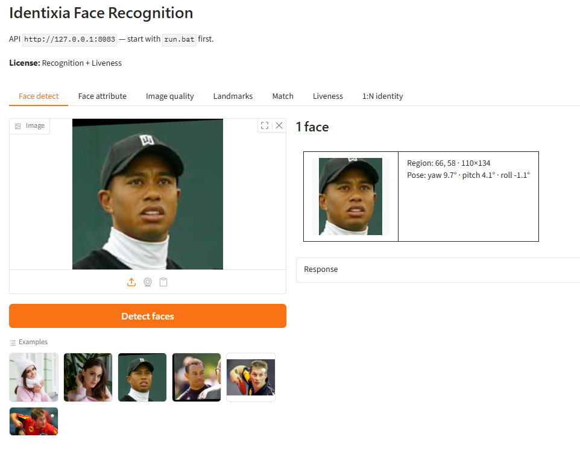
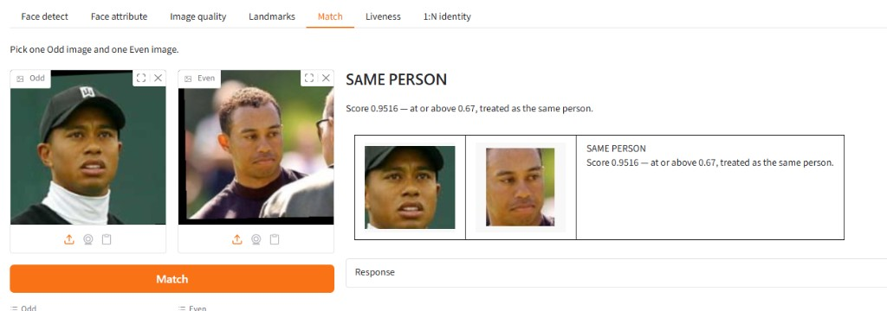
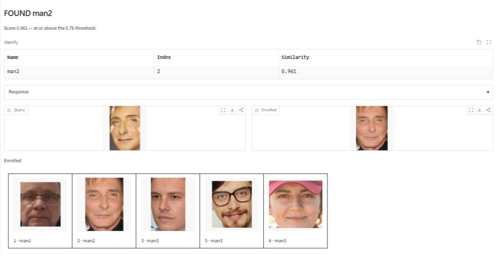

# Face recognition — Windows


## Overview

Face recognition SDK for Windows. On-premise detection, landmarks, attributes, quality, templates, and 1:1 match through a local REST API. Sample and docs included.

Processing runs **on your server (or in your container)**. Identixia does **not** receive biometric images, templates, or document scans.

| | |
| --- | --- |
| **Repository** | [`FaceRecognition-Windows`](https://github.com/identixia-IDV/FaceRecognition-Windows) |
| **Platform** | Windows |
| **Documentation** | [docs.identixia.com](https://docs.identixia.com) |


## Repository



[`identixia-IDV/FaceRecognition-Windows`](https://github.com/identixia-IDV/FaceRecognition-Windows) · [Releases](https://github.com/identixia-IDV/FaceRecognition-Windows/releases/latest)

## Capabilities

| Capability | Description |
| --- | --- |
| Face detection | Bounding box, landmarks, and pose |
| Attributes | Age, gender, and related traits when enabled |
| Quality | ICAO-style image and face quality scores |
| Templates | Compact feature vectors stored in **your** database |
| 1:1 match | Compare two images or two templates |

## Prerequisites

| Requirement | Detail |
| --- | --- |
| OS | Windows 10/11 x64 |
| Runtime | Product `lib/` (CPU) next to the server |
| Python | As required by the sample server (see repo README) |
| Port | Full face **14103** · recognition-only **14104** · face liveness **14105** · document **14102** · document liveness **14107** |
| License | `.env` `LICENSE=` or `POST /api/activate` |

## Download and place the runtime

Native engines and model databases are **not** stored in git. Every product ships `scripts/get_runtime.py`, which downloads the correct GitHub Release assets and places them where the sample expects.

### Download (recommended)

```bash
python scripts/get_runtime.py
```

To pin a specific Release tag:

```bash
python scripts/get_runtime.py --tag 1.0.0
```

| | |
| --- | --- |
| **Release asset** | GitHub Release `*-windows.zip` / `*-linux.zip` |
| **Local path after download** | `lib/cpu/` (`FaceRecognitionSDK.dll` on Windows, or the `.so` files on Linux, **and** every required `*.xdb` at the top level) |
| **Databases** | Face recognition needs the full `recognition*.xdb` set; face liveness needs `recognition-common.xdb`, `recognition-liveness.xdb`, `recognition-deepfake.xdb`; document products need `document.xdb`. |

### Manual download (optional)

Open the repository **Releases** page and download the asset named above:

```text
https://github.com/identixia-IDV/FaceRecognition-Windows/releases/latest/download/<asset>
```

Unzip so files land in the documented path — **not** nested inside an extra folder.


If databases are missing, activate/init may succeed but recognition, liveness, or OCR will fail at runtime. `get_runtime.py` checks required packs after download.


## Integration guide — start the project

Default API port for this product family: **`14104`**. Gradio demo (when shipped) uses **`14204`**.

### 1. Clone the sample

```bash
git clone https://github.com/identixia-IDV/FaceRecognition-Windows.git
cd FaceRecognition-Windows
```

### 2. Download and place the runtime

Native libraries and `*.xdb` databases are not in git. From the repository root:

```bash
python scripts/get_runtime.py
```

Files must land under `lib/cpu/` (DLLs or `.so` files **and** every required database pack). See [Download and place the runtime](#download-and-place-the-runtime).

### 3. Configure and start the server

```bash
cp -n .env.example .env   # Windows: copy .env.example .env
pip install -r requirements.txt
python run_server.py
```

Configuration lives in **`.env`**: `PORT`, `LICENSE`, `API_BASE`, `DEMO_PORT`. Shell / Compose environment variables still win over `.env`.

### 4. Machine code → license → activate

```bash
curl -s http://127.0.0.1:14104/api/machinecode
```

Send `data.machinecode` to Identixia and receive a license. Then either set `LICENSE=` in `.env` and restart, or:

```bash
curl -s -X POST http://127.0.0.1:14104/api/activate \
  -H "Content-Type: application/json" \
  -d '{\"license\":\"YOUR_KEY\"}'
curl -s http://127.0.0.1:14104/api/licenseStatus
curl -s http://127.0.0.1:14104/api/health
```

Prefer `.env` (`LICENSE=`) for the key — do not use a separate `license.txt`.

### Try a process call

```bash
curl -s -X POST http://127.0.0.1:14104/api/face/analyze \
  -H "Content-Type: application/json" \
  -d "{\"image\":\"BASE64_JPEG\"}"
```


## License and activation (server)

1. Start the API (it stays up even without a key so you can read the machine code).
2. `GET /api/machinecode` → copy `data.machinecode`.
3. Contact Identixia with that code (Docker and bare metal codes differ).
4. `POST /api/activate` with the key **or** set `LICENSE=` in `.env` and restart.
5. `GET /api/licenseStatus` → check capability flags (`recognition`, `liveness` / `authenticity`).

Control routes return the envelope `{success, code, message, request_id, data}`. Process routes return **engine / process JSON** (not the control envelope).

## API reference — HTTP (Windows / Linux / Docker)

Base URL: `http://{host}:14104`

There is **no** legacy `/api/detect`, `/api/match`, or `/api/liveness` on this stack — use `/api/face/*` only.

### Control routes (envelope)

| Method | Path | Description |
| --- | --- | --- |
| `GET` | `/api/health` | Process up (no license required) |
| `GET` | `/api/backend` | Backend / SDK info |
| `GET` | `/api/machinecode` | Machine fingerprint for licensing |
| `GET` | `/api/licenseStatus` | Flags: `recognition`, `liveness` |
| `POST` | `/api/activate` | License text, JSON `{"license":"…"}`, or multipart |

### Process routes (engine / process JSON)

Same path accepts JSON (base64 fields) or `multipart/form-data` (`image`, `image1`, `image2`, …).

| Method | Path | Body (summary) | Description |
| --- | --- | --- | --- |
| `POST` | `/api/face/analyze` | `image`, optional `cropImage` | Full analyze |
| `POST` | `/api/face/boxes` | `image` | Face boxes |
| `POST` | `/api/face/traits` | `image` | Attributes |
| `POST` | `/api/face/image-quality` | `image` | Image quality |
| `POST` | `/api/face/landmarks` | `image`, `mode` `14` or `68` | Landmarks |
| `POST` | `/api/face/quality` | `image` | Face quality |
| `POST` | `/api/face/template` | `image` | Template / feature |
| `POST` | `/api/face/compare` | `image1`, `image2` | 1:1 image match |
| `POST` | `/api/face/score` | `feature1`, `feature2` | Template similarity |

| `POST` | `/api/face/enroll` | `{ "image", "name" }` | Server gallery enroll |
| `POST` | `/api/face/search` | `{ "image", "threshold" }` | 1:N search |
| `GET` | `/api/face/gallery` | — | List gallery |
| `DELETE` | `/api/face/gallery/{id}` | — | Remove gallery entry |

### Live track (when enabled)

| Method | Path | Description |
| --- | --- | --- |
| `POST` | `/api/face/track/start` | Start a tracking session |
| `POST` | `/api/face/track/frame` | Push a frame (base64) |
| `GET` | `/api/face/track/events` | Poll track / match / liveness events |
| `POST` | `/api/face/track/stop` | Stop the session |

### Example — analyze one image

```bash
curl -s -X POST http://127.0.0.1:14104/api/face/analyze \
  -H "Content-Type: application/json" \
  -d '{"image":"BASE64_JPEG","cropImage":false}'
```

### Example — compare two images

```bash
curl -s -X POST http://127.0.0.1:14104/api/face/compare \
  -H "Content-Type: application/json" \
  -d '{"image1":"BASE64_JPEG","image2":"BASE64_JPEG"}'
```

### Example — template similarity

```bash
curl -s -X POST http://127.0.0.1:14104/api/face/score \
  -H "Content-Type: application/json" \
  -d '{"feature1":"<b64>","feature2":"<b64>"}'
```

### Example — Python analyze

```python
import base64, json, urllib.request
from pathlib import Path

image = base64.b64encode(Path("photo.jpg").read_bytes()).decode()
req = urllib.request.Request(
    "http://127.0.0.1:14104/api/face/analyze",
    data=json.dumps({"image": image, "cropImage": False}).encode(),
    headers={"Content-Type": "application/json"},
)
with urllib.request.urlopen(req, timeout=180) as resp:
    print(resp.read().decode())
```

**Postman:** import `postman/Identixia-API.postman_collection.json` (monorepo) or the product `postman/` collection, and set `baseUrl` to `http://127.0.0.1:14104`.

## Troubleshooting

| Symptom | What to check |
| --- | --- |
| Invalid license | Application / bundle id must match the key; server needs the correct machine code |
| Init failed | Runtime AAR/framework/`lib` missing or wrong ABI |
| No face / no document | Lighting, crop, distance; try still gallery image first |
| Liveness / authenticity empty | License flag off — request the matching entitlement |
| Camera black / crash | Use a **physical** device; grant camera permission |
| Docker license fails after bare-metal license | Machine codes differ — re-license the container |

| Port in use | Change host port or stop the other Identixia server |
| Multipart vs JSON | Field names must match (`image`, `image1`, `images`) |
| Envelope vs process JSON | Only control routes use `{success,code,…}`; process routes return engine JSON |

## Related platforms

Keep the same license product line across stacks. From the [Face SDK](README.md) hub:

| Platform | Docs |
| --- | --- |
| Android (full) | [Android](android.md) |
| iOS (full) | [iOS](ios.md) |
| Flutter (full) | [Flutter](flutter.md) |
| React Native (full) | [React Native](react-native.md) |
| Ionic Capacitor (full) | [Ionic Capacitor](ionic-capacitor.md) |
| Ionic Cordova (full) | [Ionic Cordova](ionic-cordova.md) |
| Windows (full) | [Windows](windows.md) |
| Linux / Docker (full) | [Linux / Docker](linux-docker.md) |
| Windows (recognition only) | [Recognition Windows](recognition-windows.md) |
| Linux (recognition only) | [Recognition Linux / Docker](recognition-linux-docker.md) |
| Liveness-only | [Android](liveness-android.md) · [iOS](liveness-ios.md) · [Windows](liveness-windows.md) · [Docker](liveness-linux-docker.md) |
| Function guides | [Recognition](recognition.md) · [Liveness](liveness.md) |

## Screenshots

<figure><figcaption>Desktop detect</figcaption></figure>

<figure><figcaption>Desktop 1:1 match</figcaption></figure>

<figure><figcaption>Desktop liveness</figcaption></figure>

<figure><figcaption>Desktop identify</figcaption></figure>

## Resources

| Resource | Link |
| --- | --- |
| **This repository** | [`identixia-IDV/FaceRecognition-Windows`](https://github.com/identixia-IDV/FaceRecognition-Windows) |
| **GitHub Releases (runtime)** | [Latest download](https://github.com/identixia-IDV/FaceRecognition-Windows/releases/latest) |
| **Runtime helper** | `python scripts/get_runtime.py` in the product clone |
| **Documentation site** | [docs.identixia.com](https://docs.identixia.com) |
| **SDK Server (HTTP)** | [SDK Server](../sdk-server/README.md) |
| **Website** | [identixia.com](https://identixia.com) |
| **Hugging Face** | [huggingface.co/Identixia](https://huggingface.co/Identixia) |
| **Docker Hub** | [hub.docker.com/u/identixia](https://hub.docker.com/u/identixia) |
| **Playground** | [playground.identixia.com](https://playground.identixia.com/) |
| **License & support** | [Request a license](../request-a-license-and-support.md) · [Contact](../contact-us.md) |

Postman collections live under each product repository’s `postman/` folder (and the monorepo `postman/Identixia-API.postman_collection.json` for all HTTP routes).

## Next steps

1. Complete **Integration guide — start the project** until the sample shows **Ready**.
2. Confirm runtime files and databases are in place (`python scripts/get_runtime.py`).
3. Activate with a license issued for **your** application id or machine code.
4. Call only the APIs your license allows; treat missing flags as “not evaluated”, not as pass.
5. Return to the [Face SDK](README.md) hub for recognition, liveness, and related platforms.


## Support



## Repository README

The following notes are adapted from the shipping repository README (exact commands and platform-specific details). Screenshots on this page use the Identixia documentation asset pack.

## Identixia Face Recognition — Windows

On-premise **face recognition** for Windows (recognition packs only). Passive liveness is a separate app: `FaceLivenessDetection-Windows`.

---

## Develop

Use this repository for face detection, templates, 1:1 match, and 1:N identification without a liveness engine. Processing stays on your host or in your container. Identixia does not receive the images.

| | |
| --- | --- |
| **Architecture** | [Where the engine runs](#-architecture) |
| **Quick start** | Follow [Initial commands](#-initial-commands), then [Run](#-run). |
| **Initialize** | [Activate, then init](#-initialize) |
| **Process** | [HTTP API](#-process) |
| **Results** | [What to read back](#-results) |
| **Requirements** | [Requirements](#-requirements) |

---

## Resources

| Resource | Where |
| --- | --- |
| **Sample** | This repository — [FaceRecognition-Windows](https://github.com/identixia-IDV/FaceRecognition-Windows) |
| **Client library** | the sample project in this repository |
| **Runtime** | [`python scripts/get_runtime.py`](#-install) · [Releases](https://github.com/identixia-IDV/FaceRecognition-Windows/releases/latest) |
| **API** | [Method list](#-api) |
| **Develop docs** | [docs.identixia.com/face-sdk/recognition-windows](https://docs.identixia.com/face-sdk/recognition-windows) |
| **License** | [License](#-license) · [Contact](#-contact) |
| **Other platforms** | [Platforms](#-platforms) |

---

## Basics

Start the server, copy the machine code, and contact us with that code to get a license. Then set `LICENSE=` in `.env` and activate (or POST `/api/activate`).

| Topic | Basic information |
| --- | --- |
| **Product** | On-premise **face recognition** for Windows |
| **What you run** | HTTP API (see `.env` / docs for the default port) |
| **Runtime** | `lib\cpu\` via `python scripts/get_runtime.py` |
| **Liveness** | Not included — use `FaceLivenessDetection-Windows` |
| **Privacy** | Biometrics stay on your host — no Identixia cloud |

---

## Install

Download the native engine files from this repository’s GitHub Release. The helper script places libraries and database packs in the correct folders.

```bash
python scripts/get_runtime.py
```

To download a specific Release tag instead of the latest build:

```bash
python scripts/get_runtime.py --tag 1.0.0
```

Unzip **directly** into `lib\cpu\`.

---

## Initial commands

```bash
git clone https://github.com/identixia-IDV/FaceRecognition-Windows.git
cd FaceRecognition-Windows
python scripts/get_runtime.py
pip install -r requirements.txt
python run_server.py
```

Configuration lives in **`.env`** (see `.env.example`): `PORT`, `LICENSE`, `API_BASE`, `DEMO_PORT`. Copy `.env.example` → `.env` and edit. Shell variables already set still win over `.env`.

```bash
curl -s http://127.0.0.1:14103/api/machinecode
```

The response is JSON. Your machine code is `data.machinecode`.

Please [contact us](#-contact) with the machine code to get a license.

Set `LICENSE=` in `.env` to the key we send you (or POST it below — activate writes `.env`):

```bash
curl -s -X POST http://127.0.0.1:14103/api/activate -H "Content-Type: application/json" -d "{\"license\":\"YOUR_KEY\"}"
```

```bash
curl -s http://127.0.0.1:14103/api/health
```

Use the face analyze / compare endpoints after activation. See [docs](https://docs.identixia.com).

---

## What you get

| Capability | What it does |
| --- | --- |
| **Detect / match** | Face detection, templates, and 1:1 compare |
| **Attributes / quality** | When packs and license allow |
| **Liveness** | Separate Face Liveness Detection product |

---

## Requirements

| | |
| --- | --- |
| API port | **14103** |
| Gradio demo port | **14203** |
| Runtime download | `python scripts/get_runtime.py` |

---

## Gradio demo

Keep the API running, then open a second terminal in the repository folder.

```bash
pip install -r requirements-demo.txt
python run_demo.py
```

Open http://127.0.0.1:14203

---

## Use in your app

Call the HTTP API from your backend or client. Full reference: [docs.identixia.com](https://docs.identixia.com).

---

## Architecture

The HTTP service and the native engine run on your machine. Docker binds the published port and reads `/etc/machine-id` for the license. Images are not uploaded to Identixia.

## Initialize

Start the server, call `GET /api/machinecode`, and send that code when you request a license. Put the key in `license.txt`, then `POST /api/activate`. Confirm with `GET /api/health` and `GET /api/licenseStatus`.

| Code | Meaning |
| ---: | --- |
| success `true` | The call was accepted |
| Activate failed | The key does not match this machine. Copy `data.machinecode` from `GET /api/machinecode` and request a key. |

## Process

After activate, POST a base64 JPEG to the process route on port **14104**. The same routes are in the Postman collection shipped with the server sample.

## Results

Read the face box, template or similarity score, and the enrolled identity for 1:N. Liveness is a separate field. Do not treat a missing liveness score as a pass.

## API

HTTP API on port **14104**. Send a JPEG as base64 JSON. Control routes return `{success, code, message, request_id, data}`.

| Call | Route |
| --- | --- |
| Health | `GET /api/health` |
| Machine code | `GET /api/machinecode` |
| Activate | `POST /api/activate` with your `license.txt` |
| License status | `GET /api/licenseStatus` |
| Detect | `POST /api/face/analyze` |
| 1:1 match | `POST /api/face/compare` |
| Template | `POST /api/face/template` |
| Liveness | Not in this build. Use a Face Liveness or full Face repository. |

```bash
curl -s http://127.0.0.1:14104/api/health
```

---

## Platforms

| | Platform | Repo |
| --- | --- | --- |

---
