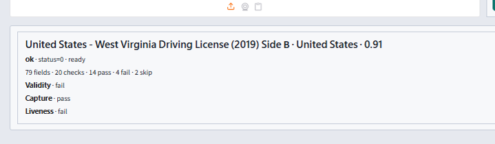
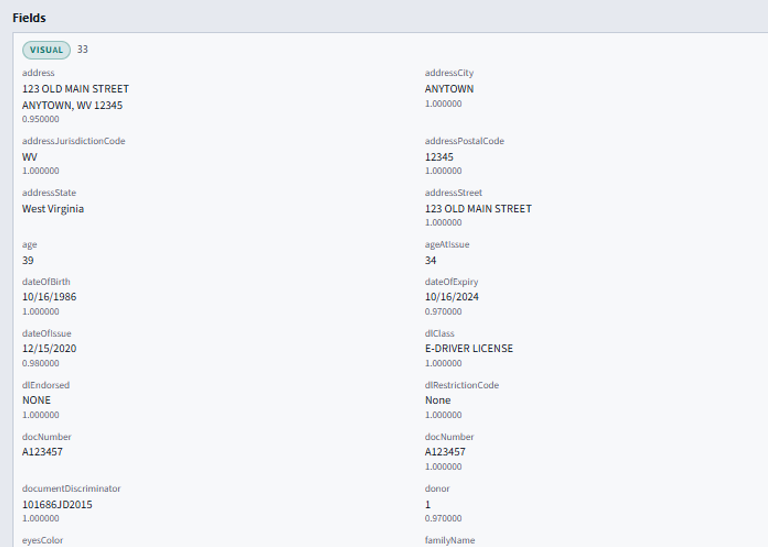
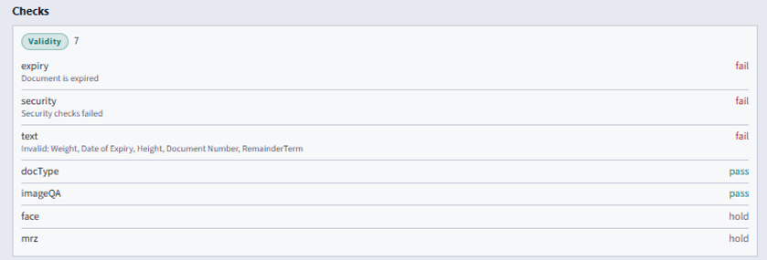
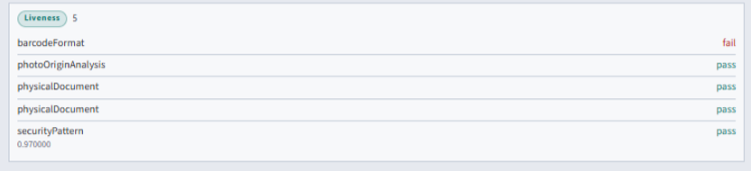
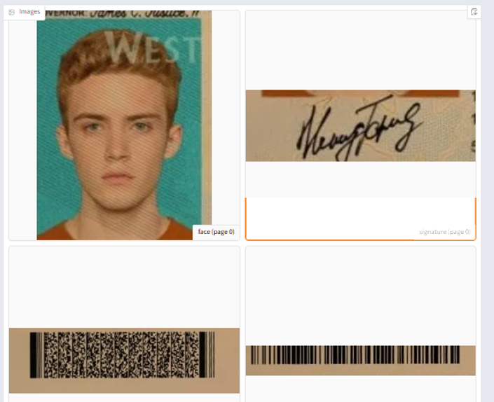

# ID Document SDK — iOS


## Overview

ID document recognition SDK for iOS. On-device passport, national ID, and driver license OCR, MRZ, and barcode capture for KYC. Document liveness runs when licensed.

Processing runs **on the device**. Identixia does **not** receive biometric images, templates, or document scans.

| | |
| --- | --- |
| **Repository** | [`ID-Document-Recognition-Liveness-Detection-iOS`](https://github.com/identixia-IDV/ID-Document-Recognition-Liveness-Detection-iOS) |
| **Platform** | iOS |
| **Documentation** | [docs.identixia.com](https://docs.identixia.com) |


## Repository



[`identixia-IDV/ID-Document-Recognition-Liveness-Detection-iOS`](https://github.com/identixia-IDV/ID-Document-Recognition-Liveness-Detection-iOS) · [Releases](https://github.com/identixia-IDV/ID-Document-Recognition-Liveness-Detection-iOS/releases/latest)

## Capabilities

| Capability | Description |
| --- | --- |
| Locate and crop | Find the ID document in a camera frame or still image |
| OCR | Visual-zone fields (name, document number, dates, and related data) |
| MRZ | Machine-readable zone parse and checksum checks |
| Barcode / QR | Extracted when present on the document |
| Front and back | Capture both sides when your workflow requires it |
| Document authenticity | Anti-spoof checks when the license includes `authenticity` |
| Structured JSON | Same result model on mobile and server — see Result JSON |

## Prerequisites

| Requirement | Detail |
| --- | --- |
| IDE | Xcode (recent stable) |
| Device | Physical iPhone for camera demos |
| Deployment | iOS 13+ (see sample project) |
| Frameworks | Vendored `.framework` / `.xcframework` from Release or Drive pack |

## Download and place the runtime

Native engines and model databases are **not** stored in git. Every product ships `scripts/get_runtime.py`, which downloads the correct GitHub Release assets and places them where the sample expects.

### Download (recommended)

```bash
python scripts/get_runtime.py
```

To pin a specific Release tag:

```bash
python scripts/get_runtime.py --tag 1.0.0
```

| | |
| --- | --- |
| **Release asset** | `docsdk.xcframework.zip` |
| **Local path after download** | `docsdk.xcframework` / `docsdk.framework` (includes `document.xdb` in the bundle) |
| **Databases** | If the framework is missing `document.xdb`, add it from the paired SDK pack before shipping. |

### Manual download (optional)

Open the repository **Releases** page and download the asset named above:

```text
https://github.com/identixia-IDV/ID-Document-Recognition-Liveness-Detection-iOS/releases/latest/download/<asset>
```

Unzip so files land in the documented path — **not** nested inside an extra folder.


If databases are missing, activate/init may succeed but recognition, liveness, or OCR will fail at runtime. `get_runtime.py` checks required packs after download.


## Integration guide — start the project

### 1. Clone the sample

```bash
git clone https://github.com/identixia-IDV/ID-Document-Recognition-Liveness-Detection-iOS.git
cd ID-Document-Recognition-Liveness-Detection-iOS
```

### 2. Download and place the runtime

See [Download and place the runtime](#download-and-place-the-runtime) below. From the repository root:

```bash
python scripts/get_runtime.py
```

### 3. Run the demo

Open the Xcode project, set your signing **Team**, and run on a physical iPhone.

Wait until Home status shows **Ready** before opening camera modes.

### 4. Activate and try every mode

1. Confirm Home / About shows a licensed **Ready** state (sample apps ship a demo key for the sample application id only).
2. Exercise each demo tile once (enroll, identify, capture, attribute, liveness, document front/back, result).
3. For your own app: request a license for **your** application id / bundle id, then call activate → init on a background thread.


## License and activation (mobile)

| | |
| --- | --- |
| **Demo id** | Sample application / bundle id shipped in the repo (document reader demo) |
| **Demo key** | Bundled for the sample id only |
| **Your app** | New applicationId / bundle id → request a new license |

### Activate → init (concept)

1. Call activate with your license string (background thread).
2. On success, call init (unpacks on-device models; may take a few seconds the first time).
3. Gate UI on Ready / license status before camera modes.
4. Never paste the demo key into a production app id.


### Status codes

| Code | Meaning |
| ---: | ------- |
| `0` | Success |
| `1` / `-1` | Invalid license |
| `2` / `-2` | Wrong application / bundle id |
| `3` / `-3` | License expired |
| `4` / `-4` | Not activated |
| `-5` | Init / model load failed |
| `-10` | Invalid argument |
| `-11` | Invalid image |
| `-12` | No face |
| `-13` | No document |
| `-16` | Liveness failed (when gated) |

Serialize native SDK calls on **one background thread**. The engine is not concurrent.


## API reference — mobile document SDK

Android, iOS, Flutter, React Native, and Ionic share the **same customer method names** and the same process JSON idea (`identity` / `readings` / `tests` / `images` / `session`).

### Lifecycle

| API | Purpose |
| --- | --- |
| `setActivation(license)` | Activate license (background thread) |
| `init()` | Load models |
| `deinit()` | Unload engine |
| `getMachineCode()` / `getLicenseStatus()` | License helpers |
| `startNewSession(optionsJson?)` | Open a process session before recognize |

### Capture and process

| API | Purpose |
| --- | --- |
| Guide / crop helpers | Align document in frame (`DocumentGuideView` / kit crop) |
| `locateDocument(image)` | Find document bounds in a frame / still |
| `recognize(front, back?, authenticity?)` | OCR + MRZ + barcode (+ authenticity when licensed) |
| `documentRecognition(front, back?)` | Recognition-only path |
| `documentLiveness(front, back?)` | Authenticity / PAD-only path |
| `documentProcess(imagesJson, rfidJson, optionsJson)` | Combined pipeline (same idea as `POST /api/document/process`) |
| `faceLiveness(image, mode?)` | Optional face PAD helper on document products that ship it |

### Result JSON (shared idea)

Top-level concepts (names may be normalized per platform):

| Area | Contents |
| --- | --- |
| Identity | Document type, country, overall score |
| Fields / readings | OCR, MRZ, barcode field rows |
| Checks / tests | Verification + image quality + security |
| Images | Portrait / document crops (base64) |
| Session | Process / request metadata when present |

See [Result JSON](result-json.md) and [Security check fields](security-fields.md).

### Integration checklist

1. Apply `install.gradle` or vendor iOS `docsdk`.
2. Activate with your app id license → `init`.
3. Capture front (and back when needed) → `recognize` or `documentProcess`.
4. Parse JSON in your app — do not depend on the demo Result UI.
5. Store fields you need in **your** database.

## Troubleshooting

| Symptom | What to check |
| --- | --- |
| Invalid license | Application / bundle id must match the key; server needs the correct machine code |
| Init failed | Runtime AAR/framework/`lib` missing or wrong ABI |
| No face / no document | Lighting, crop, distance; try still gallery image first |
| Liveness / authenticity empty | License flag off — request the matching entitlement |
| Camera black / crash | Use a **physical** device; grant camera permission |
| Docker license fails after bare-metal license | Machine codes differ — re-license the container |

## Screenshots

<figure><figcaption>Status</figcaption></figure>

<figure><figcaption>Visual fields</figcaption></figure>

<figure><figcaption>Validity checks</figcaption></figure>

<figure><figcaption>Liveness checks</figcaption></figure>

<figure><figcaption>Images</figcaption></figure>

## Resources

| Resource | Link |
| --- | --- |
| **This repository** | [`identixia-IDV/ID-Document-Recognition-Liveness-Detection-iOS`](https://github.com/identixia-IDV/ID-Document-Recognition-Liveness-Detection-iOS) |
| **GitHub Releases (runtime)** | [Latest download](https://github.com/identixia-IDV/ID-Document-Recognition-Liveness-Detection-iOS/releases/latest) |
| **Runtime helper** | `python scripts/get_runtime.py` in the product clone |
| **Documentation site** | [docs.identixia.com](https://docs.identixia.com) |
| **SDK Server (HTTP)** | [SDK Server](../sdk-server/README.md) |
| **Website** | [identixia.com](https://identixia.com) |
| **Hugging Face** | [huggingface.co/Identixia](https://huggingface.co/Identixia) |
| **Docker Hub** | [hub.docker.com/u/identixia](https://hub.docker.com/u/identixia) |
| **Playground** | [playground.identixia.com](https://playground.identixia.com/) |
| **License & support** | [Request a license](../request-a-license-and-support.md) · [Contact](../contact-us.md) |

Postman collections live under each product repository’s `postman/` folder (and the monorepo `postman/Identixia-API.postman_collection.json` for all HTTP routes).

## Next steps

1. Complete **Integration guide — start the project** until the sample shows **Ready**.
2. Confirm runtime files and databases are in place (`python scripts/get_runtime.py`).
3. Activate with a license issued for **your** application id or machine code.
4. Call only the APIs your license allows; treat missing flags as “not evaluated”, not as pass.
5. Return to the [ID Document SDK](README.md) hub for Result JSON and related platforms.


## Support



## Repository README

The following notes are adapted from the shipping repository README (exact commands and platform-specific details). Screenshots on this page use the Identixia documentation asset pack.

## Identixia ID Document Recognition and Liveness Detection — iOS

**On-device ID document recognition** for iPhone: passports, national IDs, and driver licenses with passport MRZ OCR, ID card barcode, live capture, and optional document liveness / authenticity. Designed for KYC and eKYC — **all recognition runs on device**; Identixia never receives your document images.

---

## Develop

Use this repository for passport, national ID, and driver license OCR, MRZ, and barcode capture, with document liveness when the license includes it. Processing stays on the phone. Identixia does not receive camera frames, templates, or document images.

| | |
| --- | --- |
| **Architecture** | [Where the engine runs](#-architecture) |
| **Quick start** | Follow [Initial commands](#-initial-commands), then [Run](#-run). |
| **Initialize** | [Activate, then init](#-initialize) |
| **Process** | [Camera or a still image](#-process) |
| **Results** | [What to read back](#-results) |
| **Requirements** | [Requirements](#-requirements) |

---

## Resources

| Resource | Where |
| --- | --- |
| **Sample** | This repository — [ID-Document-Recognition-Liveness-Detection-iOS](https://github.com/identixia-IDV/ID-Document-Recognition-Liveness-Detection-iOS) |
| **Client library** | the sample project in this repository |
| **Runtime** | [`python scripts/get_runtime.py`](#-install) · [Releases](https://github.com/identixia-IDV/ID-Document-Recognition-Liveness-Detection-iOS/releases/latest) |
| **API** | [Method list](#-api) |
| **Develop docs** | [docs.identixia.com/id-document-sdk/ios](https://docs.identixia.com/id-document-sdk/ios) |
| **License** | [License](#-license) · [Contact](#-contact) |
| **Other platforms** | [Platforms](#-platforms) |

---

## Basics

Read this once before cloning. Mobile demos ship a **bundled license** for the sample application / bundle id. Production apps need a new key from Identixia. [Initial commands](#-initial-commands) lists clone → place runtime → run → activate options.

| Topic | Basic information |
| --- | --- |
| **Product** | On-device **ID document recognition SDK** for iOS (KYC / eKYC) |
| **Documents** | Passport, national ID, driver license — OCR · passport MRZ · barcode / QR · optional document liveness |
| **Runtime zip** | `documentfullsdk.framework` via `python scripts/get_runtime.py` (GitHub Release) |
| **Demo id / license** | `com.identixia.documentreader.app` — bundled demo license until **12 Aug 2027** |
| **Activate** | Sample app: keep the demo id and bundled key. Your app: new applicationId / bundle id → [contact](#-contact) → call the SDK activate API (see docs). |
| **Tools** | **Xcode 15+** · physical **iPhone** |
| **UI** | Wide Camera Home · Gallery / About · one-scroll Result |
| **Privacy** | All processing on device — no Identixia cloud for document data |

---

## Initial commands

Clone the sample, place the runtime, and run it.

```bash
git clone https://github.com/identixia-IDV/ID-Document-Recognition-Liveness-Detection-iOS.git
cd ID-Document-Recognition-Liveness-Detection-iOS
python scripts/get_runtime.py
```

After `python scripts/get_runtime.py`, engines are here:

```text
documentfullsdk.framework
```

Open `DocumentReader.xcodeproj` in **Xcode 15+** → set Signing Team → Run on a physical iPhone.

Please [contact us](#-contact) to get a license for your own app. The sample already includes a demo license for its application id.

Wait until Home status = **Ready**, then use Camera / Gallery (or the face mode tiles). Confirm Result / About shows a licensed state before integrating into your own app.

---

## What you get

| Capability | What it does |
| --- | --- |

---

## Requirements

| | |
| --- | --- |
| Device | Physical **iPhone** (camera demos) |
| Tools | **Xcode 15+**, CocoaPods not required for the framework demo |
| Demo bundle id | `com.identixia.documentreader.app` |

---

## Install

> **GitHub Release:** `python scripts/get_runtime.py` (or `--tag 1.0.0`)

Unzip `documentfullsdk.framework` next to `DocumentReader.xcodeproj` at the repo root:

```text
documentfullsdk.framework
DocumentReader.xcodeproj
```

---

## Run

```text
1. git clone https://github.com/identixia-IDV/ID-Document-Recognition-Liveness-Detection-iOS.git
2. Place documentfullsdk.framework at the repo root (from the runtime zip)
3. Open DocumentReader.xcodeproj in Xcode 15+
4. Set your Signing Team; keep bundle id com.identixia.documentreader.app for the demo license
5. Run on a physical iPhone → Home Ready → Camera / Gallery
```

---

## License

| | |
| --- | --- |
| Demo bundle id | `com.identixia.documentreader.app` |
| Bundled demo license | Until **12 Aug 2027** for that id |
| Capabilities | Recognition and/or document liveness per key |

The code below shows how to use the license:

[https://github.com/identixia-IDV/ID-Document-Recognition-Liveness-Detection-iOS/blob/cdb1f37a10f8f4a04a6726e22bc565733e8b1f6c/DocumentReader/ViewController.swift#L14-L15](https://github.com/identixia-IDV/ID-Document-Recognition-Liveness-Detection-iOS/blob/cdb1f37a10f8f4a04a6726e22bc565733e8b1f6c/DocumentReader/ViewController.swift#L14-L15)

[https://github.com/identixia-IDV/ID-Document-Recognition-Liveness-Detection-iOS/blob/cdb1f37a10f8f4a04a6726e22bc565733e8b1f6c/DocumentReader/ViewController.swift#L147-L149](https://github.com/identixia-IDV/ID-Document-Recognition-Liveness-Detection-iOS/blob/cdb1f37a10f8f4a04a6726e22bc565733e8b1f6c/DocumentReader/ViewController.swift#L147-L149)

Please [contact us](#-contact) to get a license for **your own app**.

---

## Use in your app

Embed `documentfullsdk.framework`, activate with your license string, init, then `recognize` / `documentProcess` (same process JSON idea as the Windows / Docker HTTP API). See [docs](https://docs.identixia.com). Do not ship the demo bundle id with a production key mismatch.

Typical KYC path: Home Ready → Camera (or Gallery front/back) → one-scroll Result → Raw JSON for your backend mapping.

---

## Architecture

The native engine runs inside the app process. The first successful activate unpacks model databases onto the device. Keep `useLegacyPackaging = true` on Android when the engine loads `.so` files from the AAR.

## Initialize

The sample application id is already licensed. For your own id, request a new key, then call activate and init on a background thread. Open the camera only after the status is Ready. Do not reuse the sample key with a different application id.

| Code | Meaning |
| ---: | --- |
| `0` | Success |
| `1` / `-1` | Invalid license |
| `2` / `-2` | License was issued for a different application id |
| `3` / `-3` | License expired |
| `4` / `-4` | Not activated |
| `-5` | Models failed to load. Run `python scripts/get_runtime.py` and confirm the database packs are present. |
| `-12` | No face in the image |
| `-13` | No document in the image |

## Process

Capture the document with the camera, or pick a still from the gallery. Keep the whole document inside the frame.

## Results

Read identity, text fields, MRZ or barcode, then images. Authenticity checks appear only when document liveness is licensed and the image was checked.

## API

The sample and your app use the same method names.

| API | What it returns |
| --- | --- |
| `activate(license)` then `init()` | Load the engine. Call both on one background thread. |
| Camera | Live capture from the sample Home screen. |
| Gallery | Still image of a passport, national ID, or driver license. |
| `recognize` / document process | Identity, MRZ, barcode, and field text. |
| Document liveness | Presentation-attack result when the license includes it. |

---

## Platforms

| | Platform | Repo |
| --- | --- | --- |

Document liveness only: [ID-Document-Liveness-Detection-Docker](https://github.com/identixia-IDV/ID-Document-Liveness-Detection-Docker)

---
